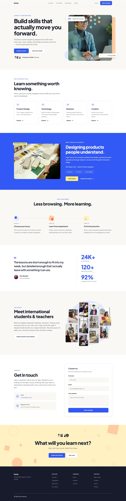
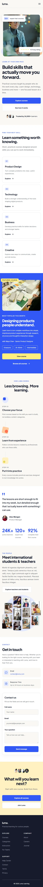

# Luma — Buzzvel Front-End Challenge

My solution to the Buzzvel Front-End Engineer coding challenge (November 2026): a responsive
landing page for "Luma", built from the provided Figma design with **Next.js (App Router),
TypeScript and Tailwind CSS**.

- **Live demo:** https://buzzvel-frontend-challenge-nine.vercel.app/
- **Video walkthrough (3 min):** https://www.loom.com/share/c93cfa0f7931408f99dc9bad27c76806

| Desktop | Mobile |
| --- | --- |
|  |  |

## How to run it

You need Node.js 20.9 or newer.

```bash
npm install      # install dependencies
npm run dev      # run locally at http://localhost:3000
npm run build    # production build
npm start        # run the production build
```

Other scripts: `npm run lint`, `npm run typecheck` and `npm test`.

On Vercel the page's share links use the production domain automatically. Elsewhere, set
`NEXT_PUBLIC_SITE_URL` to the site's address.

## What I built

All sections from the desktop and mobile designs:

- **Header**, with a menu button on mobile
- **Hero**
- **Course categories**
- **Featured course**
- **How it works**
- **Testimonial and stats**
- **Students & teachers photo collage**
- **Contact form**
- **Final call-to-action**
- **Footer**

The page works on mobile, tablet and desktop. I tested it from 320px up to 1440px wide.

**Interactions:**

- **Mobile menu:** opens and closes with the button, the Escape key, or by tapping a link.
- **Contact form:** checks the fields (name, a valid email, a short message), shows clear error
  messages, then shows a success message. There's no backend, so sending is simulated.
- **Hover and focus states** on every link, button and card, plus smooth scrolling to each section.

## Key decisions

- **Following the design closely.** I took the exact fonts, colours, sizes and spacing from the
  Figma file, and exported the images and icons from it. Then I compared my page with the design
  side by side, at desktop and mobile sizes, and fixed the differences.
- **Reusable components.** Buttons, section headings, cards and similar pieces are shared components
  with typed props. All text and lists live in one data file (`src/data/content.ts`), so the
  components only handle layout.
- **Accessibility.** Proper HTML structure (header, nav, main, footer, headings in order), a "skip to
  content" link, descriptive alt text on images, visible focus outlines and full keyboard support.
  An automated accessibility check (axe) found no issues.
- **Performance.** The page is pre-rendered as static HTML. Images are resized and served in modern
  formats (AVIF/WebP), fonts are self-hosted, and only the menu and the form use JavaScript.
- **Motion kept light.** The design has no animations, so I only added small hover effects and
  transitions, and they turn off for users who prefer reduced motion. I removed an intro animation on
  the hero because it made the page feel slower to load on mobile.

**Lighthouse** (production build, tested locally):

| Mobile | Desktop |
| --- | --- |
|  |  |

## Things that were unclear in the design

The desktop and mobile designs don't always match, so I picked one consistent version:

- All three "How it works" steps are labelled "Step 01" on desktop. I used 01, 02 and 03, as on
  mobile.
- The mobile email field has a Portuguese placeholder ("seuemail@exemplo.com"). I used the English
  one from desktop.
- The design doesn't show what the open mobile menu looks like, so I designed a simple dropdown in
  the same style as the header.
- Two grey/white text colours were slightly below the accessibility contrast standard. I made them a
  tiny bit stronger; the difference isn't visible.
- The "Meet international students & teachers" text is placeholder (Lorem ipsum) in the design. I
  kept it as it is.

## Known gaps

- The contact form doesn't actually send messages (no backend, as allowed in the brief).
- Links like "Log in", "Terms" or "Careers" have no pages of their own, so they scroll to the most
  relevant section.
- I tested in Chrome (desktop and mobile view), not on a real iPhone or in Firefox.

## Time spent

About **TODO** hours.

## Use of AI

I used **Claude Code** as a helper during this challenge:

- reading the measurements and exporting the images from the Figma file,
- setting up the project and drafting components,
- comparing my page with the design screenshots to catch differences,
- running checks (accessibility, Lighthouse, form and menu behaviour).

I reviewed and adjusted the code myself. I checked the result by testing the page on mobile and
desktop, using it with the keyboard, running the production build, lint and tests, and comparing it
with the Figma design. I can explain any part of the code.
